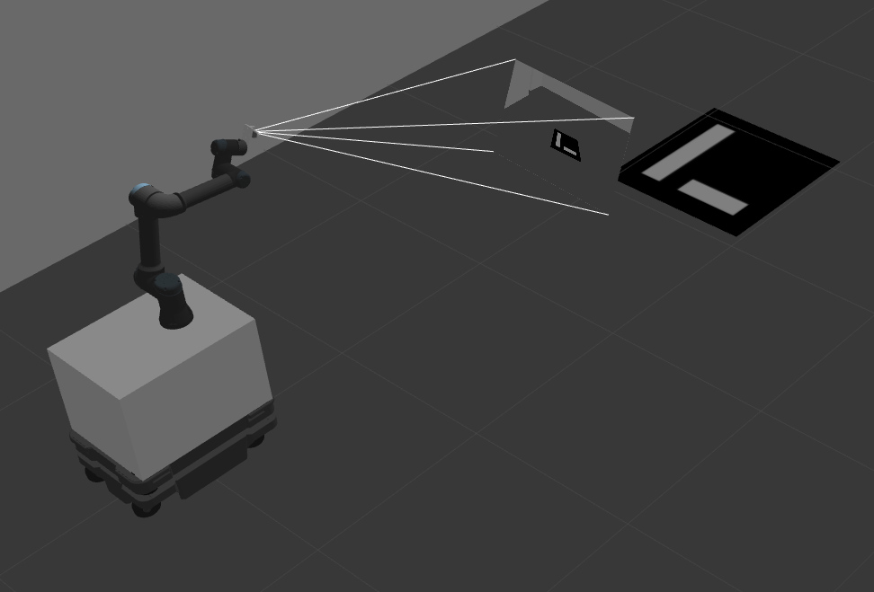

<p align="center">
  
</p>

<h1 align="center">MiR 250 + UR5e Mobile Manipulator — ROS 2 Workspace</h1>

<p align="center">
  <strong>An integrated ROS 2 Humble workspace for autonomous mobile manipulation using a MiR 250 base, UR5e arm, Robotiq gripper, and Intel RealSense D435i camera.</strong>
</p>

<p align="center">
  <a href="https://docs.ros.org/en/humble/"></a>
  <a href="#license"></a>
  <a href="https://ubuntu.com/"></a>
  <a href="https://gazebosim.org/"></a>
  <a href="https://moveit.ros.org/"></a>
  <a href="https://navigation.ros.org/"></a>
</p>

---

## 📋 Table of Contents

- [Overview](#overview)
- [Features](#features)
- [System Architecture](#system-architecture)
- [Package Structure](#package-structure)
- [Prerequisites](#prerequisites)
- [Installation](#installation)
- [Quick Start](#quick-start)
  - [1. Gazebo Simulation](#1-gazebo-simulation)
  - [2. SLAM Mapping](#2-slam-mapping)
  - [3. Autonomous Navigation](#3-autonomous-navigation)
  - [4. Arm Manipulation (MoveIt 2)](#4-arm-manipulation-moveit-2)
  - [5. ArUco Marker Detection](#5-aruco-marker-detection)
- [Troubleshooting](#troubleshooting)
- [Contributing](#contributing)
- [Acknowledgements](#acknowledgements)
- [License](#license)

---

## Overview

This workspace provides a **complete mobile manipulation pipeline** combining:

| Component | Hardware/Software |
|---|---|
| **Mobile Base** | MiR 250 (differential drive) |
| **Manipulator** | Universal Robots UR5e (6-DOF) |
| **Gripper** | Robotiq 2F-85 |
| **Perception** | Intel RealSense D435i (RGB-D + IMU) |
| **Simulation** | Gazebo Classic 11 |
| **Navigation** | Nav2 (AMCL + SLAM Toolbox) |
| **Motion Planning** | MoveIt 2 |
| **Marker Detection** | ArUco (OpenCV) |

The system supports **SLAM mapping**, **autonomous navigation**, **arm manipulation**, and **vision-guided pick-and-place** — all within a unified Gazebo simulation environment.

---

## Features

- 🤖 **Unified URDF/Xacro model** — MiR 250 base + UR5e arm + Robotiq gripper + RealSense D435i in a single robot description
- 🗺️ **SLAM & Mapping** — Build 2D occupancy grid maps using SLAM Toolbox with async mapping
- 🧭 **Autonomous Navigation** — Nav2-based path planning and obstacle avoidance with AMCL localization
- 🦾 **Motion Planning** — MoveIt 2 integration for UR5e arm control with trajectory planning
- 👁️ **Vision Pipeline** — ArUco marker detection with pose estimation via RealSense camera
- 🎯 **Vision-Guided Manipulation** — ArUco marker pose → navigation goal or manipulation target
- 🎮 **Teleoperation** — Keyboard control for the mobile base via `teleop_twist_keyboard`
- ⚙️ **ros2_control** — Hardware abstraction for both mobile base (diff drive) and arm (joint trajectory)

---

## System Architecture

```
┌─────────────────────────────────────────────────────────────┐
│                    Gazebo Classic Simulation                  │
│  ┌─────────┐  ┌──────────┐  ┌─────────┐  ┌──────────────┐  │
│  │ MiR 250 │──│  UR5e    │──│ Robotiq │  │  RealSense   │  │
│  │  Base   │  │   Arm    │  │ Gripper │  │   D435i      │  │
│  └────┬────┘  └────┬─────┘  └─────────┘  └──────┬───────┘  │
│       │            │                             │          │
└───────┼────────────┼─────────────────────────────┼──────────┘
        │            │                             │
   ┌────▼────┐  ┌────▼─────┐               ┌──────▼───────┐
   │ros2_ctrl│  │ros2_ctrl │               │  Image Proc  │
   │DiffDrive│  │JointTraj │               │  ArUco Det.  │
   └────┬────┘  └────┬─────┘               └──────┬───────┘
        │            │                             │
   ┌────▼────┐  ┌────▼─────┐               ┌──────▼───────┐
   │  Nav2   │  │ MoveIt 2 │◄──────────────│  Pose Est.   │
   │AMCL/SLAM│  │ Planning │               │  ArUco→Goal  │
   └─────────┘  └──────────┘               └──────────────┘
```

---

## Package Structure

```
ros2_ws/
├── src/
│   ├── mir_robot/                          # Main project repository
│   │   ├── mir_robot/                      # Core MiR packages
│   │   │   ├── mir_description/            #   URDF/Xacro models & meshes
│   │   │   ├── mir_driver/                 #   MiR bridge & fake joint publishers
│   │   │   ├── mir_gazebo/                 #   Gazebo launch files & worlds
│   │   │   ├── mir_msgs/                   #   Custom MiR message definitions
│   │   │   ├── mir_navigation/             #   Nav2 config, SLAM & navigation launch
│   │   │   ├── mir_restapi/                #   MiR REST API client
│   │   │   └── mir_robot/                  #   Metapackage
│   │   ├── Universal_Robots_ROS2_Driver/   # UR5e driver & controllers
│   │   ├── Universal_Robots_ROS2_Description/ # UR robot URDF models
│   │   ├── realsense2_description/         # RealSense D435i URDF
│   │   ├── realsense_gazebo_plugin/        # Gazebo plugin for RealSense
│   │   ├── robotiq_description/            # Robotiq gripper URDF & meshes
│   │   ├── ros2_aruco/                     # ArUco marker detection
│   │   ├── point_cloud_functions/          # Point cloud processing utilities
│   │   ├── simple_moveit2_universal_robots_movement/ # MoveIt 2 examples
│   │   └── gazebo_models/                  # Custom Gazebo models (ArUco tags)
│   ├── ira_laser_tools/                    # Laser scan merger utility
│   └── twist_stamper/                      # Twist message stamping utility
├── my_map.yaml                             # Pre-built navigation map config
├── my_map.pgm                              # Pre-built navigation map image
└── README.md
```

---

## Prerequisites

| Requirement | Version |
|---|---|
| **Ubuntu** | 22.04 LTS (Jammy Jellyfish) |
| **ROS 2** | Humble Hawksbill |
| **Gazebo** | Classic 11 |
| **Python** | 3.10+ |
| **colcon** | Latest |

---

## Installation

### 1. Install ROS 2 Humble

Follow the [official installation guide](https://docs.ros.org/en/humble/Installation/Ubuntu-Install-Debians.html) if ROS 2 is not yet installed.

### 2. Install System Dependencies

```bash
sudo apt-get update && sudo apt-get install -y \
  ros-humble-ros2-control \
  ros-humble-ros2-controllers \
  ros-humble-gazebo-ros-pkgs \
  ros-humble-gazebo-ros2-control \
  ros-humble-nav2-bringup \
  ros-humble-slam-toolbox \
  ros-humble-moveit \
  python3-vcstool \
  python3-rosdep
```

### 3. Clone & Build

```bash
# Create workspace
mkdir -p ~/ros2_ws/src
cd ~/ros2_ws/

# Clone this repository
git clone https://github.com/nguyenbaquan079-spec/mir-ur5e-mobile-manipulator-ros2.git src/mir_robot

# Import linked repositories
vcs import < src/mir_robot/mir_robot/ros2.repos src --recursive

# Install ROS dependencies
sudo apt update
rosdep update --rosdistro=humble
rosdep install --from-paths src --ignore-src -r -y --rosdistro humble

# Build
source /opt/ros/humble/setup.bash
colcon build --symlink-install
```

### 4. Environment Setup

Add the following to your `~/.bashrc`:

```bash
source /opt/ros/humble/setup.bash
source ~/ros2_ws/install/setup.bash
source /usr/share/gazebo/setup.sh
```

---

## Quick Start

### 1. Gazebo Simulation

Launch the full mobile manipulator in Gazebo with a maze world:

```bash
# Source Gazebo (required!)
source /usr/share/gazebo/setup.sh

# Launch simulation
ros2 launch mir_gazebo mobile_manipulator.launch.py world:=maze
```

### 2. SLAM Mapping

Build a 2D map of the environment using SLAM Toolbox:

```bash
# Terminal 2: Launch SLAM
ros2 launch mir_navigation mapping.py use_sim_time:=true \
  slam_params_file:=$(ros2 pkg prefix mir_navigation)/share/mir_navigation/config/mir_mapping_async_sim.yaml

# Terminal 3: Drive around with keyboard
ros2 run teleop_twist_keyboard teleop_twist_keyboard \
  --ros-args -r /cmd_vel:=/diff_cont/cmd_vel_unstamped

# Save the map when done
ros2 run nav2_map_server map_saver_cli -f ~/ros2_ws/my_map
```

### 3. Autonomous Navigation

Navigate using a pre-built map:

```bash
# Terminal 1: Gazebo
ros2 launch mir_gazebo mobile_manipulator.launch.py world:=maze \
  rviz_config_file:=$(ros2 pkg prefix mir_navigation)/share/mir_navigation/rviz/mir_nav.rviz

# Terminal 2: Localization (AMCL)
ros2 launch mir_navigation amcl.py use_sim_time:=true \
  map:=$(ros2 pkg prefix mir_navigation)/share/mir_navigation/maps/maze.yaml

# Terminal 3: Navigation
ros2 launch mir_navigation navigation.py use_sim_time:=true
```

> **💡 Tip:** In RViz, use **2D Pose Estimate** to set the robot's initial position matching Gazebo, then use **Nav2 Goal** to send navigation targets.

### 4. Arm Manipulation (MoveIt 2)

Control the UR5e arm with MoveIt 2 (can run alongside navigation):

```bash
ros2 launch ur_moveit_config ur_moveit.launch.py \
  ur_type:=ur5e \
  prefix:=ur_ \
  use_sim_time:=true \
  launch_rviz:=true
```

> **⚠️ Important:** If trajectory execution fails, edit the MoveIt controller config:
> - Set `scaled_joint_trajectory_controller` → `default: false`
> - Set `joint_trajectory_controller` → `default: true`

### 5. ArUco Marker Detection

Vision-guided manipulation using ArUco markers:

```bash
# Detect ArUco markers
ros2 launch ros2_aruco aruco_recognition.launch.py

# Send marker pose as navigation goal
ros2 run ros2_aruco aruco_pose_to_nav_goal

# Send marker pose as manipulation target
ros2 run ros2_aruco aruco_pose_to_manipulate

# Transform marker pose to UR base frame
ros2 run ros2_aruco aruco_pose_to_moveit
```

---

## Troubleshooting

<details>
<summary><strong>🔴 Gazebo crashes with shared_ptr assertion error</strong></summary>

Source the Gazebo environment before launching:

```bash
source /usr/share/gazebo/setup.sh
```

</details>

<details>
<summary><strong>🔴 MoveIt launch fails with <code>LC_NUMERIC</code> error</strong></summary>

Set the locale before launching MoveIt:

```bash
export LC_NUMERIC=en_US.UTF-8
```

</details>

<details>
<summary><strong>🔴 "Gazebo already open elsewhere" error</strong></summary>

Kill any existing Gazebo server:

```bash
killall gzserver
```

</details>

<details>
<summary><strong>🔴 MoveIt plan succeeds but execution fails</strong></summary>

Edit the MoveIt controller YAML config file:

```yaml
# Change this:
scaled_joint_trajectory_controller:
  default: true       # ← set to false
joint_trajectory_controller:
  default: false      # ← set to true
```

</details>

---

## Contributing

Contributions are welcome! Please follow these steps:

1. **Fork** the repository
2. **Create** a feature branch (`git checkout -b feature/amazing-feature`)
3. **Commit** your changes (`git commit -m 'feat: add amazing feature'`)
4. **Push** to the branch (`git push origin feature/amazing-feature`)
5. **Open** a Pull Request

Please follow [Conventional Commits](https://www.conventionalcommits.org/) for commit messages.

---

## Acknowledgements

This project integrates and builds upon the work of several open-source projects:

| Component | Source | License |
|---|---|---|
| MiR 250 3D models | [DFKI-NI/mir_robot](https://github.com/DFKI-NI/mir_robot) | BSD-3-Clause |
| UR5e driver & models | [UniversalRobots/Universal_Robots_ROS2_Driver](https://github.com/UniversalRobots/Universal_Robots_ROS2_Driver) | BSD-3-Clause |
| RealSense Gazebo plugin | [PAL Robotics](https://github.com/pal-robotics/realsense_gazebo_plugin) | Apache-2.0 |
| RealSense description | [IntelRealSense/realsense-ros](https://github.com/IntelRealSense/realsense-ros) | Apache-2.0 |
| Robotiq gripper | [ros-industrial/robotiq](https://github.com/ros-industrial/robotiq) | BSD-3-Clause |
| IRA Laser Tools | [iralaser/ira_laser_tools](https://github.com/iralab-unibo/ira_laser_tools) | BSD-2-Clause |

Special thanks to [Spartan-Velanjeri](https://github.com/Spartan-Velanjeri/UR-MiR-mobile-manipulator) for the original mobile manipulator integration.

---

## License

This project is distributed under the **BSD-3-Clause License**. See [LICENSE](LICENSE) for details.

Individual packages may have their own licenses — please check the `LICENSE` or `package.xml` files within each package.

---

<p align="center">
  <sub>Built with ❤️ using ROS 2 Humble | MiR 250 + UR5e + RealSense D435i</sub>
</p>
